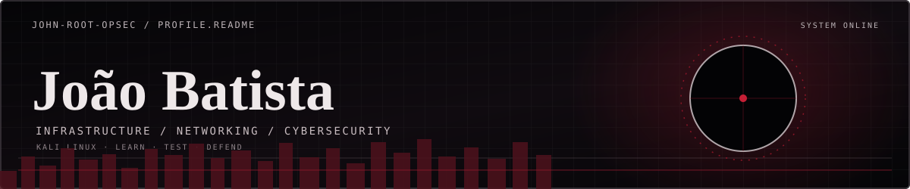
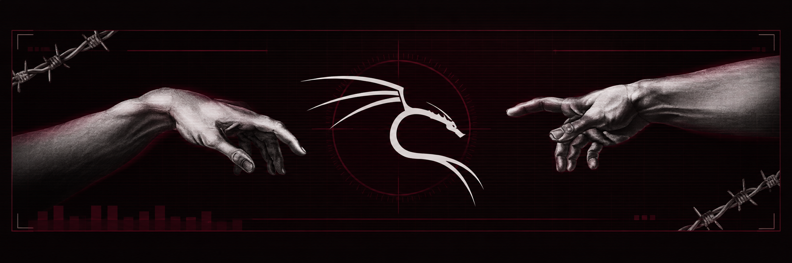
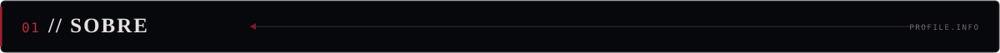
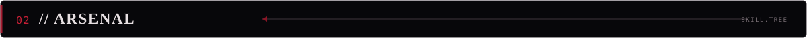
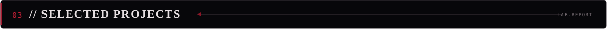
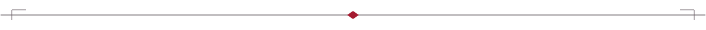

  
   
  <strong>IT INFRASTRUCTURE&nbsp; • &nbsp;NETWORKING&nbsp; • &nbsp;CYBERSECURITY&nbsp; • &nbsp;PYTHON</strong>
    
  
  
    
  

 

  

I'm an IT professional with a degree in **Systems Analysis and Development**, focused on infrastructure, computer networks and information security. My background includes IT support, Windows environments and troubleshooting. I develop my skills through practical labs, Python automation, and Red Team and Blue Team studies.

**FOCUS** &nbsp; Infrastructure · Networking · Linux · Cybersecurity · Automation

 

  

**DEVELOPMENT**

  

**CYBERSECURITY TOOLKIT**

  
  
  
  
  

**SYSTEMS & NETWORKING**

  
   
  
  

  

 

  

**[Enterprise Network Defense](https://github.com/john-root-opsec/enterprise-network-defense-in-depth)**  
Corporate network design · VLANs · ACLs · DHCP · DNS

**[Gmail Automation](https://github.com/john-root-opsec/gmail-auto-cleaner)**  
Python · Gmail API · OAuth 2.0 · REST · Batch Processing

**[WebSec Lab](https://github.com/john-root-opsec/websec-lab)**  
Web security lab · HTTP analysis · Python detection concepts · *In development*

 

  

**CURRENT FOCUS** &nbsp; Linux · Network Administration · Ethical Hacking · Defensive Security · Python Automation · Front-end Development

I'm interested in junior opportunities in **IT Infrastructure, Networking, IT Support and Cybersecurity**. All security testing is performed in authorized labs and environments.

  
    
  <strong>LEARN CONTINUOUSLY&nbsp; • &nbsp;BUILD PRACTICALLY&nbsp; • &nbsp;SECURE RESPONSIBLY</strong>
   
  

