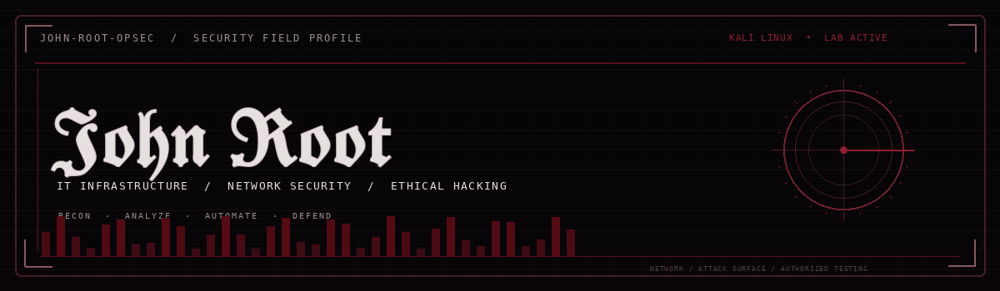
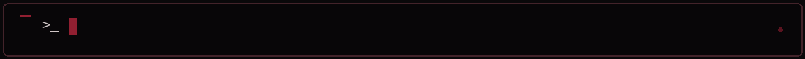
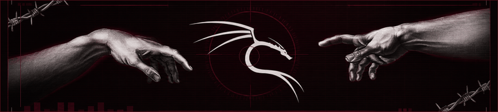
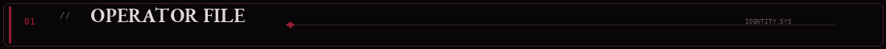
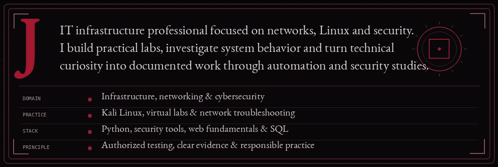
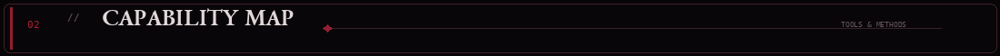
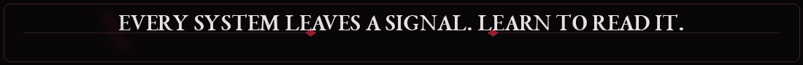
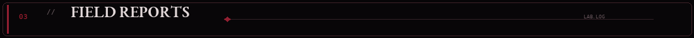
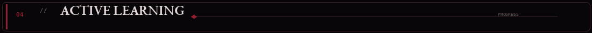
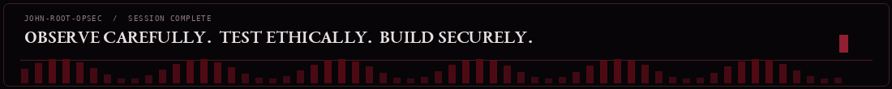

**OFFENSIVE SECURITY / AUTHORIZED LABS**  
   

**NETWORK ANALYSIS & DEFENSE**  
 <kbd>TCP/IP</kbd> <kbd>VLANs</kbd> <kbd>ACLs</kbd> <kbd>DHCP</kbd> <kbd>DNS</kbd> <kbd>GLPI</kbd> <kbd>Active Directory</kbd>

**SYSTEMS, VIRTUALIZATION & DEVELOPMENT**  
<kbd>Kali Linux</kbd> <kbd>Linux</kbd> <kbd>Windows</kbd> <kbd>VirtualBox</kbd> <kbd>Cisco Packet Tracer</kbd> <kbd>Python</kbd> <kbd>JavaScript</kbd> <kbd>TypeScript</kbd> <kbd>React</kbd> <kbd>SQLite</kbd> <kbd>REST APIs</kbd> <kbd>OAuth 2.0</kbd>

| PROJECT | OPERATION NOTES |
| :--- | :--- |
| **[Enterprise Network Defense](https://github.com/john-root-opsec/enterprise-network-defense-in-depth)** | Corporate network design · VLANs · routing · ACLs · DHCP · DNS |
| **[Gmail Automation](https://github.com/john-root-opsec/gmail-auto-cleaner)** | Python · Gmail API · OAuth 2.0 · REST · pagination · batch processing |
| **[WebSec Lab](https://github.com/john-root-opsec/websec-lab)** | Controlled web security lab · HTTP analysis · Python detection concepts · *In development* |

**COMPLETED** · Systems Analysis and Development degree  
**COMPLETED** · AI-900 — Microsoft Azure AI Fundamentals  
**CURRENT TRACK** · Linux administration · networking · authorized ethical hacking labs · defensive security · Python automation · front-end development

Open to junior opportunities in **IT Infrastructure, Networking, IT Support and Cybersecurity**.

All security testing is limited to systems and environments where I have permission.

Credits & implementation notes

Animated panels are original looping GIF assets generated for this profile. Technology icons: [Skill Icons](https://skillicons.dev/). Badges: [Shields.io](https://shields.io/). Display typography uses a Fraktur Unicode treatment and Garamond-style editorial lettering in the raster artwork.

