

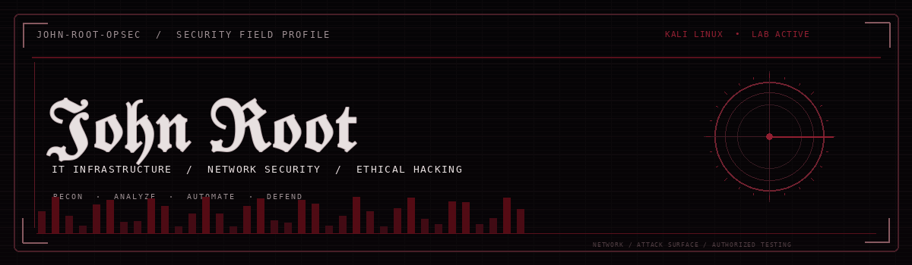

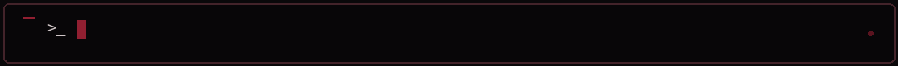

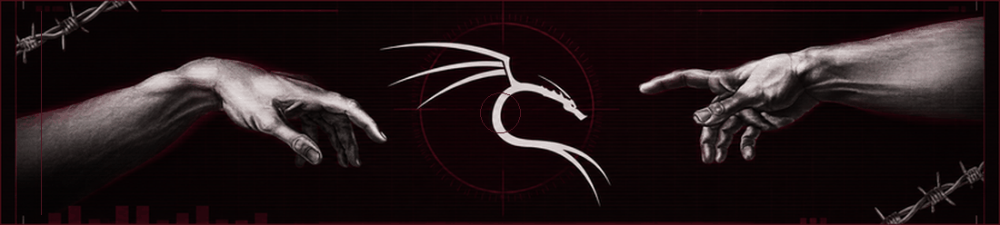

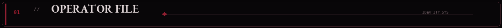

----

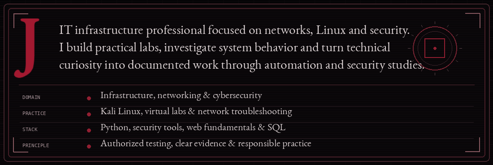

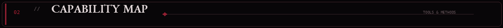

----

<a href="https://nmap.org/" title="Nmap">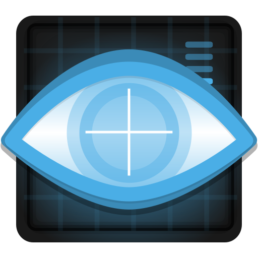</a>
<a href="https://www.wireshark.org/" title="Wireshark">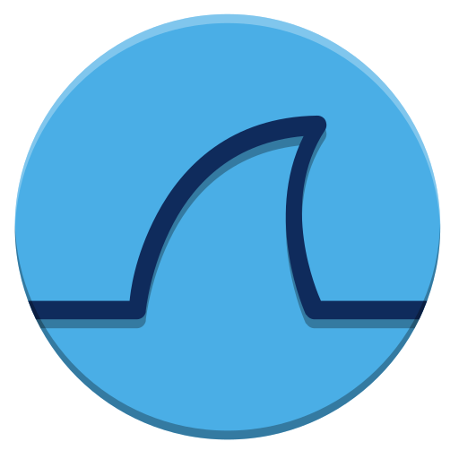</a>
<a href="https://portswigger.net/burp" title="Burp Suite" >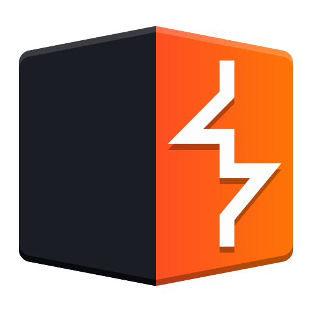</a>
<a href="https://sqlmap.org/" title="sqlmap">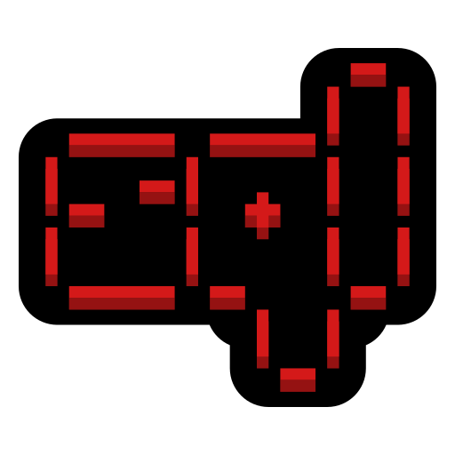</a>

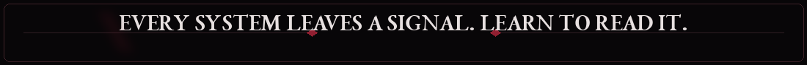

----

**OFFENSIVE SECURITY / AUTHORIZED LABS**  

**NETWORK ANALYSIS & DEFENSE**  
<kbd>TCP/IP</kbd> <kbd>VLANs</kbd> <kbd>ACLs</kbd> <kbd>DHCP</kbd> <kbd>DNS</kbd> <kbd>GLPI</kbd> <kbd>Active Directory</kbd>

**SYSTEMS, VIRTUALIZATION & DEVELOPMENT**  
<kbd>Kali Linux</kbd> <kbd>Linux</kbd> <kbd>Windows</kbd> <kbd>VirtualBox</kbd> <kbd>Cisco Packet Tracer</kbd> <kbd>Python</kbd> <kbd>JavaScript</kbd> <kbd>TypeScript</kbd> <kbd>React</kbd> <kbd>SQLite</kbd> <kbd>REST APIs</kbd> <kbd>OAuth 2.0</kbd>

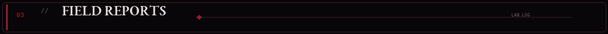

 
  
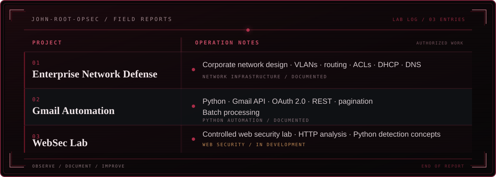

 
  
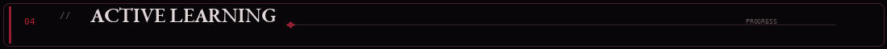

----

**COMPLETED** · **Systems Analysis and Development degree**  
**COMPLETED** · **Linux Server Administrator**
**CURRENT TRACK** · **Linux administration · networking · authorized ethical hacking labs · defensive security · Python automation · front-end development**

----

Open to junior opportunities in **IT Infrastructure, Networking, IT Support and Cybersecurity**.

**All security testing is limited to systems and environments where I have permission.**

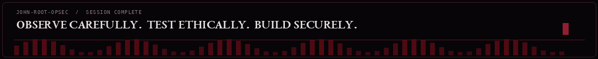

Credits & implementation notes

Animated panels are original looping GIF assets generated for this profile. Technology icons: [Skill Icons](https://skillicons.dev/). Security application icons: [Kali Flat Icons](https://github.com/l0gicx/kali-flat-icons) (GPL-3.0; license included in `assets/icons/`). Badges: [Shields.io](https://shields.io/). Display typography uses a Fraktur Unicode treatment and Garamond-style editorial lettering in the raster artwork.

