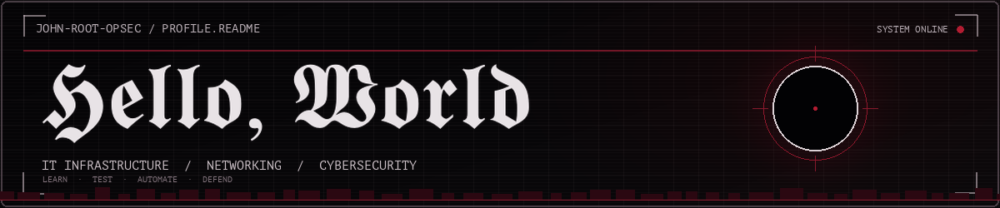
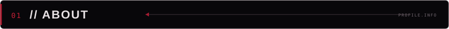
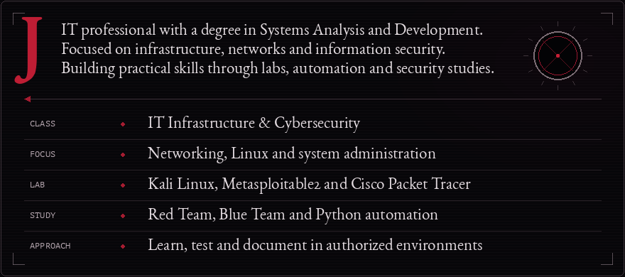
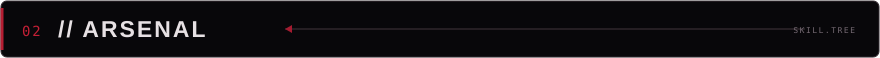
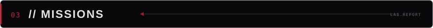
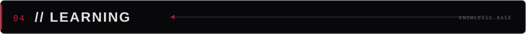

  

## 

## 

◆ **CYBERSECURITY TOOLKIT** 
    

◆ **NETWORKING &amp; SYSTEMS** 
<kbd>Cisco Packet Tracer</kbd> <kbd>VirtualBox</kbd> <kbd>VLANs</kbd> <kbd>TCP/IP</kbd> <kbd>DHCP</kbd> <kbd>DNS</kbd> <kbd>Windows Support</kbd> <kbd>Linux CLI</kbd>

◆ **DEVELOPMENT &amp; AUTOMATION** 
<kbd>Python</kbd> <kbd>JavaScript</kbd> <kbd>TypeScript</kbd> <kbd>React</kbd> <kbd>HTML</kbd> <kbd>CSS</kbd> <kbd>SQLite</kbd> <kbd>REST APIs</kbd> <kbd>OAuth 2.0</kbd>

## 

| PROJECT | BRIEFING |
| :--- | :--- |
| **[Enterprise Network Defense](https://github.com/john-root-opsec/enterprise-network-defense-in-depth)** | Corporate network design · VLANs · ACLs · DHCP · DNS · Routing |
| **[Gmail Automation](https://github.com/john-root-opsec/gmail-auto-cleaner)** | Python · Gmail API · OAuth 2.0 · REST · Pagination · Batch processing |
| **[WebSec Lab](https://github.com/john-root-opsec/websec-lab)** | Web security lab · HTTP analysis · Python detection concepts · *In development* |

## 

- **Systems Analysis and Development** — degree completed.
- **AI-900 — Microsoft Azure AI Fundamentals** — completed.
- **Current focus:** Linux administration, networking, authorized security labs, Python automation and front-end development.

## 

  
  
<em>Infrastructure, networking, cybersecurity or practical technology projects.</em>

  
  
    
  
  

