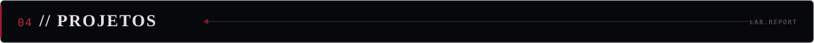
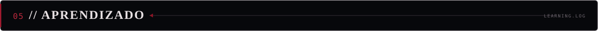
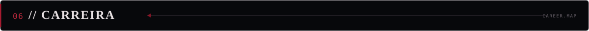
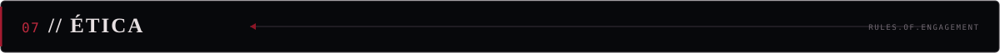
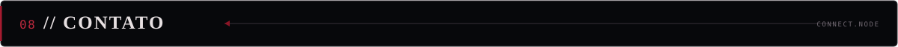

  
   
   
  
   
   
  <strong>IT INFRASTRUCTURE&nbsp; • &nbsp;NETWORKING&nbsp; • &nbsp;CYBERSECURITY&nbsp; • &nbsp;PYTHON</strong>
   
  Building, testing, automating and securing technology environments.
   
   
  
  
  

 

  

<table>
  <tr>
    <td width="7%" valign="top"></td>
    <td valign="top">
      I'm an IT professional with a degree in <strong>Systems Analysis and Development</strong>, focused on IT infrastructure, computer networks and information security. My background includes IT support, troubleshooting, Windows environments and infrastructure operations.
        
      I keep expanding my technical knowledge through hands-on labs, automation projects and cybersecurity studies. I explore both <strong>Red Team</strong> and <strong>Blue Team</strong> practices while developing my programming skills with Python and studying front-end technologies.
        
      My goal is to combine technical problem-solving, automation and security to build and maintain more reliable technology environments.
    </td>
  </tr>
</table>

<table>
  <tr><td width="24%"><code>CLASS</code></td><td>IT Infrastructure &amp; Cybersecurity</td></tr>
  <tr><td><code>FOCUS</code></td><td>Networking, Linux, system administration and information security</td></tr>
  <tr><td><code>STUDY</code></td><td>Red Team, Blue Team, Python and front-end development</td></tr>
  <tr><td><code>LAB</code></td><td>Kali Linux, Metasploitable2, Cisco Packet Tracer and practical environments</td></tr>
  <tr><td><code>APPROACH</code></td><td>Learn continuously, test in authorized environments and document the results</td></tr>
</table>

 

  

<strong>PROGRAMMING &amp; DEVELOPMENT</strong>

  

<strong>CYBERSECURITY TOOLKIT</strong>

  
  
  
  
  

<strong>OPERATING SYSTEMS &amp; INFRASTRUCTURE</strong>

  
   
  
  

<strong>VERSION CONTROL</strong>

  

  

  ◇ INFRASTRUCTURE &nbsp; ◇ NETWORKING &nbsp; ◇ LINUX ADMINISTRATION &nbsp; ◇ ETHICAL HACKING &nbsp; ◇ PYTHON AUTOMATION &nbsp; ◇ TRAFFIC ANALYSIS &nbsp; ◇ WEB SECURITY &nbsp; ◇ DEFENSIVE SECURITY

 

  

<table>
  <tr>
    <td width="50%" valign="top">
      <strong>01 / INFRASTRUCTURE &amp; NETWORKING</strong>  
      • Cisco Packet Tracer and corporate network design 
      • VLAN segmentation, routing and ACLs 
      • DHCP, DNS, gateways and network services 
      • TCP/IP fundamentals and troubleshooting
    </td>
    <td width="50%" valign="top">
      <strong>02 / RED TEAM &amp; ETHICAL HACKING</strong>  
      • Authorized security testing in lab environments 
      • Nmap discovery and service enumeration 
      • Burp Suite and web security fundamentals 
      • sqlmap and Metasploit lab exercises 
      • Metasploitable2 practice environment
    </td>
  </tr>
  <tr>
    <td width="50%" valign="top">
      <strong>03 / BLUE TEAM &amp; DEFENSIVE SECURITY</strong>  
      • Wireshark network traffic analysis 
      • Security logs and event analysis 
      • Threat detection and monitoring fundamentals 
      • Incident investigation concepts
    </td>
    <td width="50%" valign="top">
      <strong>04 / PYTHON &amp; AUTOMATION</strong>  
      • Python scripting and task automation 
      • Gmail API integration and OAuth 2.0 
      • REST APIs, JSON and pagination 
      • Batch processing and file handling
    </td>
  </tr>
  <tr>
    <td width="50%" valign="top">
      <strong>05 / WEB DEVELOPMENT</strong>  
      • HTML, CSS and JavaScript 
      • TypeScript and React — currently studying 
      • Flask and FastAPI fundamentals 
      • SQL and SQLite fundamentals
    </td>
    <td width="50%" valign="top">
      <strong>06 / IT SUPPORT &amp; SYSTEMS</strong>  
      • Windows troubleshooting and installation 
      • Active Directory and Microsoft 365 
      • GLPI and support ticket workflows 
      • CMD, PowerShell and Linux terminal
    </td>
  </tr>
</table>

Practical labs • Technical documentation • Continuous learning

 

  

<table>
  <tr>
    <td valign="top" width="14%"><code>PROJECT 01</code></td>
    <td valign="top">
      <strong>Corporate Network Infrastructure — Cisco Packet Tracer</strong> 
      A practical corporate network design focused on segmentation, connectivity and security. 
      VLANs · Routing · ACLs · DHCP · DNS · Network Services 
      <a href="https://github.com/john-root-opsec/enterprise-network-defense-in-depth">VIEW REPOSITORY ↗</a>
    </td>
  </tr>
  <tr>
    <td valign="top"><code>PROJECT 02</code></td>
    <td valign="top">
      <strong>Gmail Automation with Python</strong> 
      Python automation using Gmail API and OAuth 2.0 to manage messages and repetitive tasks. 
      Python · Google APIs · OAuth 2.0 · REST · Pagination · Batch Processing 
      <a href="https://github.com/john-root-opsec/gmail-auto-cleaner">VIEW REPOSITORY ↗</a>
    </td>
  </tr>
  <tr>
    <td valign="top"><code>PROJECT 03</code></td>
    <td valign="top">
      <strong>WebSec Lab — From Vulnerability to Detection</strong> 
      A laboratory project intended to connect web security testing, event analysis and Python-based detection in a controlled environment. 
      DVWA · HTTP Logs · Python · Detection Concepts · Documentation 
      <em>Status: In development.</em> 
      <a href="https://github.com/john-root-opsec/websec-lab">VIEW REPOSITORY ↗</a>
    </td>
  </tr>
</table>

 

  

<table>
  <tr><td width="25%"><code>COMPLETED</code></td><td><strong>AI-900 — Microsoft Azure AI Fundamentals</strong></td></tr>
  <tr><td><code>LABS</code></td><td>Cisco Packet Tracer — corporate networking and infrastructure exercises</td></tr>
  <tr><td><code>STUDY</code></td><td>Linux, Kali Linux and cybersecurity tools</td></tr>
  <tr><td><code>STUDY</code></td><td>Red Team fundamentals and authorized security testing</td></tr>
  <tr><td><code>STUDY</code></td><td>Blue Team fundamentals and defensive analysis</td></tr>
  <tr><td><code>IN PROGRESS</code></td><td>Front-end development — HTML, CSS, JavaScript, TypeScript and React</td></tr>
  <tr><td><code>CONTINUOUS</code></td><td>Python scripting, automation and practical development</td></tr>
</table>

 

  

  
  
  
  
  
  
  

I'm interested in opportunities where I can apply my current skills, contribute to practical projects and continue growing in infrastructure, networking and cybersecurity.

 

  

<table>
  <tr>
    <td align="center" width="10%"><strong>◈</strong></td>
    <td>
      <strong>Responsible Security Practice</strong> 
      All security testing and demonstrations are intended for educational purposes and authorized environments. I support responsible vulnerability research, controlled laboratory testing, proper documentation and security improvements. Testing systems without authorization is outside the scope of my work.
    </td>
  </tr>
</table>

 

  
    
  I'm always interested in connecting with IT professionals, cybersecurity practitioners, developers and people who enjoy sharing technical knowledge.
    
  
  
    
  <strong>LEARN CONTINUOUSLY. &nbsp; BUILD PRACTICALLY. &nbsp; SECURE RESPONSIBLY.</strong>
   
  JOHN-ROOT-OPSEC / END OF PROFILE
   
  

