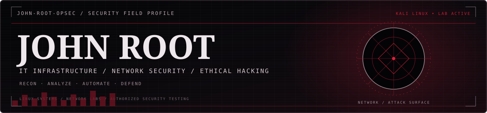
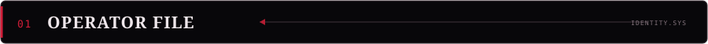
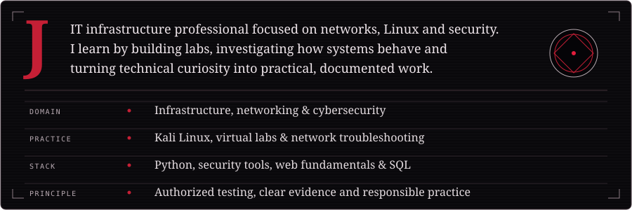
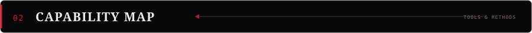
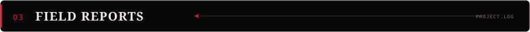
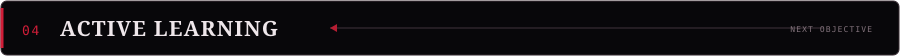
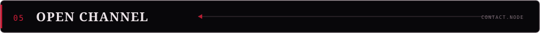

  

## 

## 

**OFFENSIVE SECURITY / AUTHORIZED LABS** 

**NETWORK ANALYSIS & DEFENSE** 

<kbd>TCP/IP</kbd> <kbd>VLANs</kbd> <kbd>ACLs</kbd> <kbd>DHCP</kbd> <kbd>DNS</kbd> <kbd>GLPI</kbd> <kbd>Active Directory</kbd>

**SYSTEMS, VIRTUALIZATION & DEVELOPMENT** 
<kbd>Kali Linux</kbd> <kbd>Linux</kbd> <kbd>Windows</kbd> <kbd>VirtualBox</kbd> <kbd>Cisco Packet Tracer</kbd> 
<kbd>Python</kbd> <kbd>JavaScript</kbd> <kbd>TypeScript</kbd> <kbd>React</kbd> <kbd>SQLite</kbd> <kbd>REST APIs</kbd> <kbd>OAuth 2.0</kbd>

## 

| PROJECT | OPERATION NOTES |
| :--- | :--- |
| **[Enterprise Network Defense](https://github.com/john-root-opsec/enterprise-network-defense-in-depth)** | Corporate network architecture · VLAN segmentation · ACLs · DHCP · DNS |
| **[Gmail Automation](https://github.com/john-root-opsec/gmail-auto-cleaner)** | Python automation · Gmail API · OAuth 2.0 · REST · pagination · batch processing |
| **[WebSec Lab](https://github.com/john-root-opsec/websec-lab)** | Controlled web security lab · HTTP analysis · Python detection concepts · *In development* |

## 

- **Systems Analysis and Development** — degree completed.
- **AI-900 — Microsoft Azure AI Fundamentals** — completed.
- **Current track:** Linux administration, networking, ethical hacking labs, defensive security, Python automation and front-end development.

## 

Open to junior opportunities in **IT Infrastructure, Networking, IT Support and Cybersecurity**.

All security testing is limited to systems and environments where I have permission.

